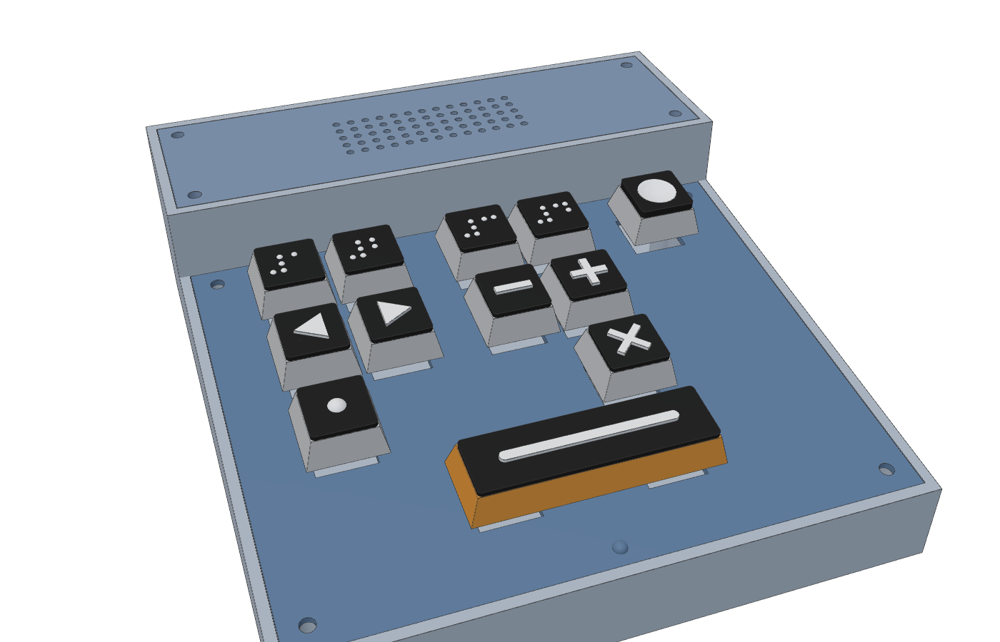

# CarenDMR-Tastenfeld – CAD-Modell

Parametrisches Modell in Python mit [CadQuery](https://cadquery.readthedocs.io).
Entwurf 2: Keilform (vorne 20 hoch, 7° ansteigend) mit Lautsprecher-Podest.
Maßzeichnung: `../gehaeuse.png`, Konzept: `docs/TASTENFELD_KONZEPT.md`.



## Fertige Dateien

| Ordner | Format | Wofür |
|---|---|---|
| `out/step/` | STEP | CAD-Programm öffnen und weiterbearbeiten |
| `out/stl/` | STL | Slicer (Bambu Studio) und Drucker |

`out/step/baugruppe.step` enthält alle Teile in Einbaulage.

| Teil | Anzahl | Material | Druck |
|---|---|---|---|
| `unterteil` | 1 | PETG | Boden auf dem Druckbett, keine Stützen nötig |
| `tastenplatte` | 1 | PETG | Unterseite auf dem Druckbett (flach, Noppe oben) |
| `podestdeckel` | 1 | PETG | flach |
| `kappe_*` (11 Stück) | je 1 | PETG | Oberseite nach oben, Stützen nur „auf dem Druckbett“ (für den Stößel innen) |
| `kappe_ptt` | 1 | PETG | wie die Kappen |
| `fuss_tpu` | 4 | TPU | flach |
| `probestreifen_ausschnitt` | 1 | PETG | flach, **zuerst drucken** |

## Kappen drucken

Der Stößel (Kreuz) hängt innen in der Kappe und endet 1,6 über der
Unterkante. Bambu Studio meldet ihn deshalb als „schwebend“ – er braucht eine
kleine Stütze. Empfohlen:

- Kappe **mit der Oberseite nach oben** drucken (Braille-Punkte und Symbole
  liegen frei und werden sauber).
- Stützen an, Typ „Baum (automatisch)“, **„Nur auf Druckbett“**. Dann entsteht
  nur unter dem Stößel eine kleine Stütze, die sich mit einer Pinzette
  herausziehen lässt.
- Nicht auf dem Kopf drucken: Dann liegen die Braille-Punkte auf Stützen und
  werden rau.

| Datei | Taste | Symbol |
|---|---|---|
| `kappe_favorit_1` … `_4` | Favorit 1–4 | Braille: Zahlzeichen + Ziffer 1–4 |
| `kappe_tg_zurueck` / `kappe_tg_vor` | TG zurück / vor | Dreieck ◀ / ▶ |
| `kappe_leiser` / `kappe_lauter` | Leiser / Lauter | Steg − / Kreuz + |
| `kappe_verbinden` | Verbinden | Noppe |
| `kappe_trennen` | Trennen | ✕ |
| `kappe_beenden` | Beenden | Mulde |
| `kappe_ptt` | PTT | Längsrille |

## Reihenfolge

1. **Probestreifen** drucken. Er hat fünf Ausschnitte 13,8 / 13,9 / 14,0 / 14,1 / 14,2;
   die Zahl der Kerben am Rand (1–5) zeigt, welcher es ist. Einen Gateron Brown
   einsetzen: Der passende Ausschnitt lässt den Schalter hörbar einrasten und
   hält ihn ohne Wackeln.
2. Den Wert in `tastenfeld.py` bei `cut` eintragen (Vorgabe 14,0) und neu erzeugen.
3. Eine Kappe und die PTT-Kappe zur Probe drucken und auf die Schalter stecken.
   Klemmt die PTT, `ptt_switch_gap` anpassen.
4. Tastenplatte, Unterteil, Podestdeckel, restliche Kappen, Füße drucken.

## Montage

- M3-Einschmelzmuttern (Loch Ø4, 6 tief) mit dem Lötkolben in die 8 Dome.
- Schalter von oben in die Tastenplatte klipsen, Litzen anlöten, Kappen aufstecken.
- Tastenplatte mit 4 × M3 auf die schräge Auflage, Podestdeckel mit 4 × M3.
- USB-Kabel durch das Loch hinten (Ø6), innen mit Kabelbinder um die zwei Pfosten.
- BOOTSEL erreichen: Podestdeckel abschrauben.

## Neu erzeugen (nach Maßänderung)

```powershell
cd C:\ABDevelop\CarenDMR\hardware\keypad\cad
..\..\..\.venv\Scripts\python.exe -m pip install -r requirements.txt
```

```powershell
cd C:\ABDevelop\CarenDMR\hardware\keypad\cad
..\..\..\.venv\Scripts\python.exe tastenfeld.py
```

Alle Maße stehen oben in `tastenfeld.py` in `Params` (Winkel, Höhen,
Tastenabstände, Ausschnitt, Spiel, Lochgitter …).

## Noch nicht im Modell

Halterungen für Lautsprecher, Vibrationsmodul, PAM8302 und Pico H fehlen noch,
weil die Maße erst nachgemessen werden müssen (Außenmaß, Lochabstand,
Schraubengröße). Bis dahin mit doppelseitigem Klebeband oder Heißkleber fixieren.
