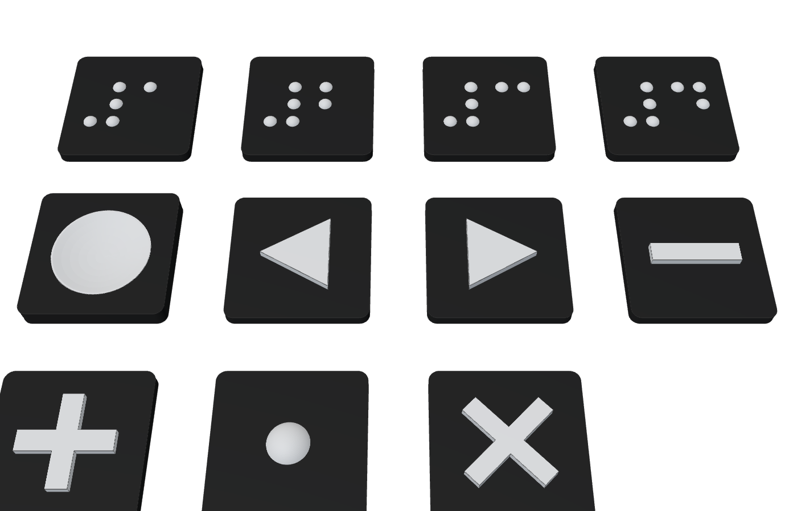

# CarenDMR-Tastenfeld – CAD-Modell

Parametrisches Modell in Python mit [CadQuery](https://cadquery.readthedocs.io).
Entwurf 2: Keilform (vorne 20 hoch, 7° ansteigend) mit Lautsprecher-Podest.
Maßzeichnung: `../gehaeuse.png`, Konzept: `docs/TASTENFELD_KONZEPT.md`.


## Fertige Dateien

| Ordner | Format | Wofür |
|---|---|---|
| `out/step/` | STEP | CAD-Programm öffnen und weiterbearbeiten |
| `out/stl/` | STL | Slicer (Bambu Studio) und Drucker |

`out/step/baugruppe.step` enthält alle Teile in Einbaulage.

| Teil | Anzahl | Material | Druck |
|---|---|---|---|
| `unterteil` | 1 | PETG | Boden auf dem Druckbett, keine Stützen nötig |
| `tastenplatte` | 1 | PETG | Unterseite auf dem Druckbett (flach, Noppe oben) |
| `podestdeckel` | 1 | PETG | flach |
| `kappe` | **11** | PETG | **auf dem Kopf** (flache Oberseite auf dem Druckbett), keine Stützen |
| `kappe_ptt` | 1 | PETG | auf dem Kopf, keine Stützen |
| Plättchen (siehe unten) | 11 | PLA schwarz + weiß | flach, Zeichen nach oben, keine Stützen |
| `fuss_tpu` | 4 | TPU | flach |
| `probestreifen_ausschnitt` | 1 | PETG | flach |

## Kennzeichnungs-Plättchen (zweifarbig)



Die Kappen sind oben flach und alle gleich. Die Kennzeichnung ist ein
Plättchen 14,3 × 14,3 × 1,2 (Beenden 2,0), das auf die Kappe geklebt wird
(Sekundenkleber oder doppelseitiges Klebeband, Kanten bündig).

Jedes Plättchen besteht aus **zwei Teilen**: `…_basis.stl` (Grundplatte, z. B.
schwarz) und `…_zeichen.stl` (erhabenes Zeichen, z. B. weiß).

**Alle 11 auf einmal drucken:**
`out/stl/plaettchen_alle_basis.stl` und `out/stl/plaettchen_alle_zeichen.stl`
**gleichzeitig** in Bambu Studio importieren. Auf die Frage, ob die Dateien
**ein Objekt mit mehreren Teilen** sind, mit **Ja** antworten. Dann in der
Objektliste dem Teil „basis“ Schwarz und dem Teil „zeichen“ Weiß zuweisen.
Einzelne Plättchen liegen in `out/stl/plaettchen/`.

| Plättchen | Taste | Zeichen |
|---|---|---|
| `favorit_1` … `favorit_4` | Favorit 1–4 | Braille: Zahlzeichen + Ziffer 1–4 (Standardmaß: Punkt Ø1,5, 0,5 hoch, Abstand 2,5, Zelle 6,0) |
| `tg_zurueck` / `tg_vor` | TG zurück / vor | Dreieck ◀ / ▶ (0,8 hoch) |
| `leiser` / `lauter` | Leiser / Lauter | Steg − / Kreuz + |
| `verbinden` | Verbinden | Noppe (Ø4, 1,2 hoch) |
| `trennen` | Trennen | ✕ |
| `beenden` | Beenden | Mulde (1,0 tief, weißer Boden) |

Die PTT braucht kein Plättchen – sie ist die einzige breite Taste.

## Reihenfolge

1. **Probestreifen** drucken. Er hat fünf Ausschnitte 13,8 / 13,9 / 14,0 / 14,1 / 14,2;
   die Zahl der Kerben am Rand (1–5) zeigt, welcher es ist. Einen Gateron Brown
   einsetzen: Der passende Ausschnitt lässt den Schalter hörbar einrasten und
   hält ihn ohne Wackeln.
2. Den Wert in `tastenfeld.py` bei `cut` eintragen (Vorgabe 14,0) und neu erzeugen.
3. Eine Kappe und die PTT-Kappe zur Probe drucken (auf dem Kopf) und auf die
   Schalter stecken. Klemmt die PTT, `ptt_switch_gap` anpassen.
4. Plättchen zweifarbig drucken, eins zur Probe aufkleben und mit Caren fühlen.
5. Tastenplatte, Unterteil, Podestdeckel, restliche Kappen, Füße drucken.

## Montage

- M3-Einschmelzmuttern (Loch Ø4, 6 tief) mit dem Lötkolben in die 8 Dome.
- Schalter von oben in die Tastenplatte klipsen, Litzen anlöten, Kappen aufstecken,
  Plättchen aufkleben (Lage siehe Vorschau).
- Tastenplatte mit 4 × M3 auf die schräge Auflage, Podestdeckel mit 4 × M3.
- USB-Kabel durch das Loch hinten (Ø6), innen mit Kabelbinder um die zwei Pfosten.
- BOOTSEL erreichen: Podestdeckel abschrauben.

## Neu erzeugen (nach Maßänderung)

```powershell
cd C:\ABDevelop\CarenDMR\hardware\keypad\cad
..\..\..\.venv\Scripts\python.exe -m pip install -r requirements.txt
```

```powershell
cd C:\ABDevelop\CarenDMR\hardware\keypad\cad
..\..\..\.venv\Scripts\python.exe tastenfeld.py
```

Alle Maße stehen oben in `tastenfeld.py` in `Params` (Winkel, Höhen,
Tastenabstände, Ausschnitt, Spiel, Lochgitter …).

## Noch nicht im Modell

Halterungen für Lautsprecher, Vibrationsmodul, PAM8302 und Pico H fehlen noch,
weil die Maße erst nachgemessen werden müssen (Außenmaß, Lochabstand,
Schraubengröße). Bis dahin mit doppelseitigem Klebeband oder Heißkleber fixieren.
